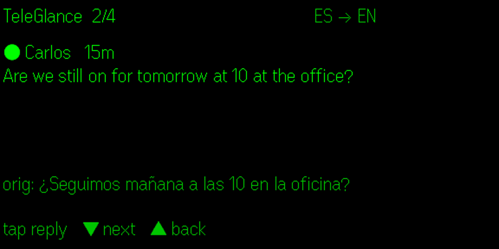
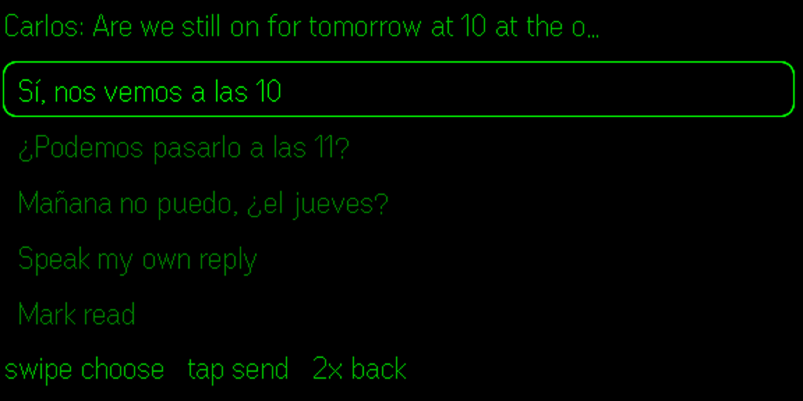
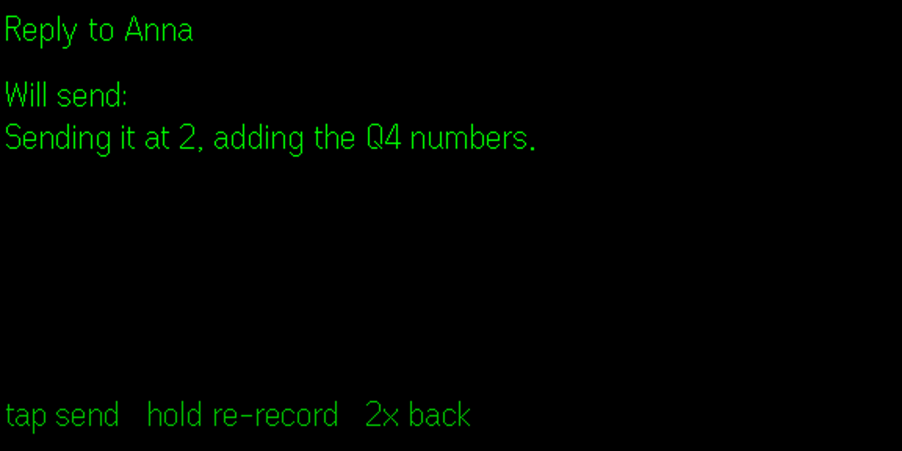
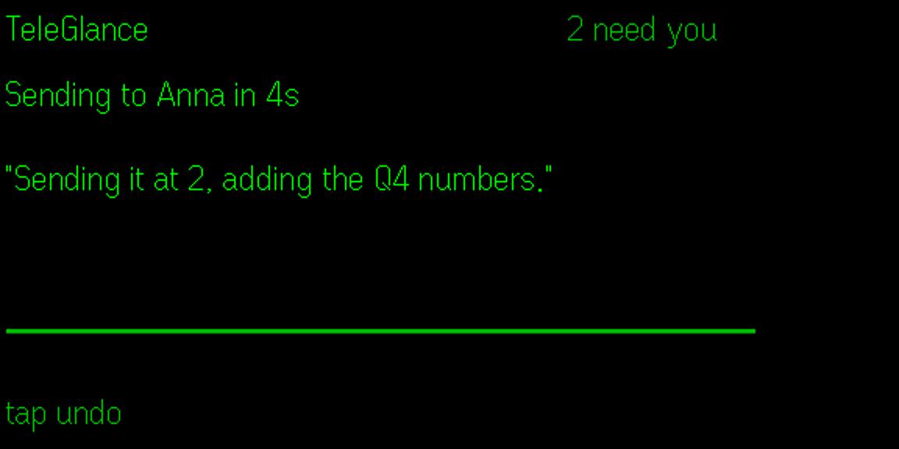
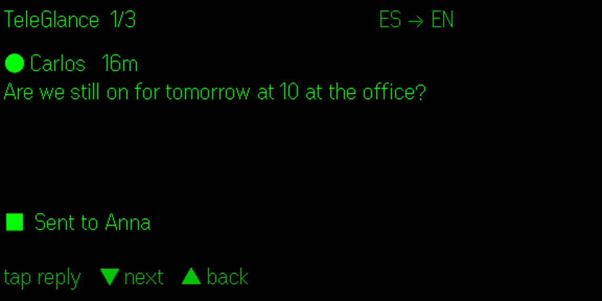
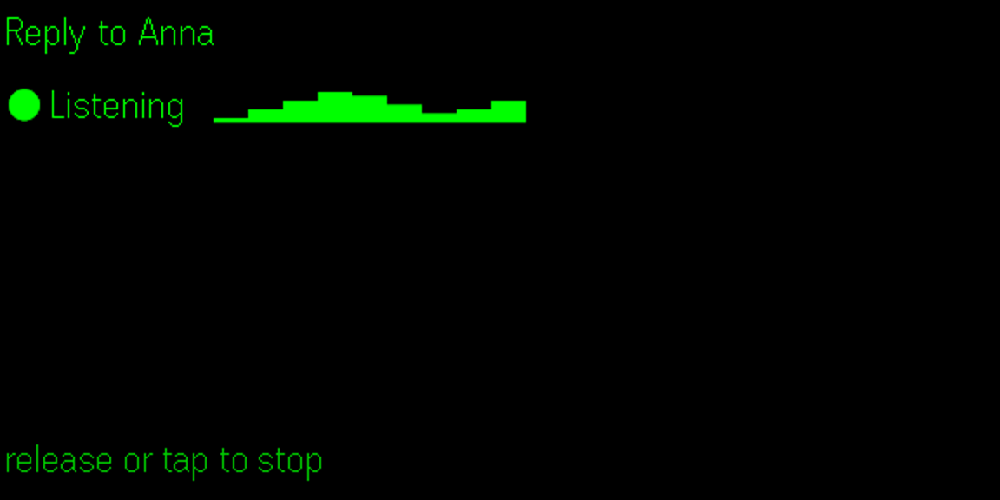
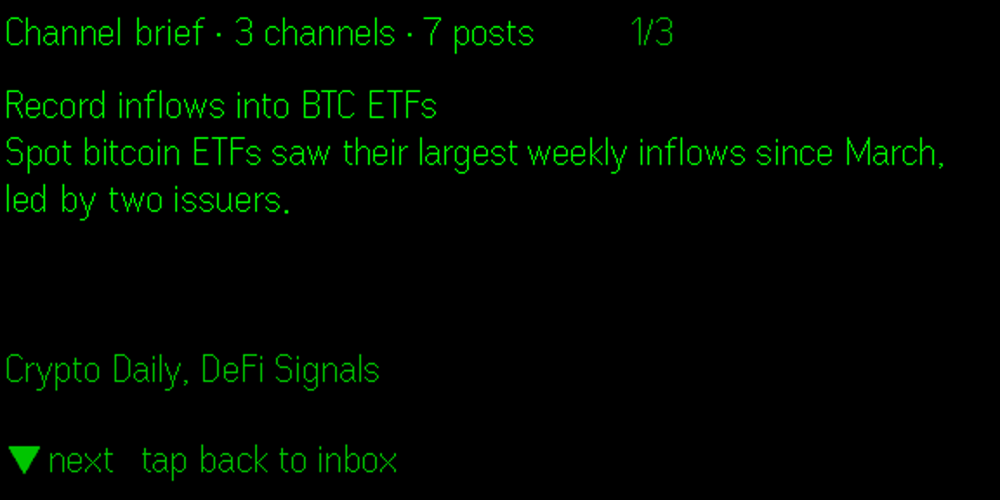

# TeleGlance

**Your Telegram, at a glance on Even Realities G2.** See only the chats that matter, know which messages need you, and reply with one tap or one sentence, without taking out your phone.

Built for the [Heads Up: Even Realities Hackathon](https://dorahacks.io/hackathon/even-realities/detail), **Track 01 · Messaging & News** (also entered for *Best Telegram integration*).


## The problem

Telegram is where work groups, family and crypto communities live, and it never stops buzzing. Checking it means pulling out the phone, opening the app and scrolling through 30 chats to find the two messages that actually wait for you. On G2 you have a private display in your glasses, but no way to read and answer Telegram there.

## Who it's for

People who live in Telegram: founders, traders, community managers, remote teams. Anyone who wants to stay reachable in meetings, on the move or while cooking, without the phone in hand.

## How it works

1. **Focus inbox.** On your phone you pick the chats that matter (for example your work group and family). Only their unread messages reach the glasses, one per screen.
2. **"Needs you" radar.** The LLM flags messages that ask you something, mention you or set a deadline. They come first, with a one-line gist (`AI: Needs the deck before 3pm`).
3. **One-tap replies.** Tap: three reply drafts that fit the chat's tone and language. Swipe to pick, tap to send.
4. **Voice replies.** Hold the touchpad (or tap "Speak my own reply"), say one sentence, release. Whisper transcribes the G2 microphone audio, the LLM cleans it up ("two" → "2", filler words gone), you tap to send.
5. **Undo window.** Every send waits 5 seconds; tap to cancel.
6. **Auto-translation.** A Spanish message shows up in English, with the original underneath, and the reply goes out in Spanish.
7. **Channel brief.** From the glasses menu: your crypto/news channels merged into 3 points, with the channels that reported each story.
8. **Mark read / mute 1 h** right from the reply list.

| Focus + gist | Translation | Reply drafts | Voice |
|---|---|---|---|
|  |  |  |  |
| **Undo window** | **Sent** | **Listening** | **Channel brief** |
|  |  |  |  |

### Controls

| Where | Gesture | Action |
|---|---|---|
| Inbox | swipe down / up | next / previous message |
| Inbox | tap | reply drafts |
| Inbox, reply list | hold | voice reply |
| Reply list | swipe + tap | send draft, speak, mark read, mute 1 h |
| Voice | release or tap | stop recording; tap again to send |
| Sending | tap | undo |
| Anywhere | tap + hold (system menu) | Channel brief · Mark all read · Refresh |
| Inbox | double tap | exit (system dialog) |

Works with the G2 temple touchpads and the R1 ring.

## Architecture

```
Even G2 + R1  ──BLE──  TeleGlance app (WebView in the Even Realities app)  ──HTTPS──  TeleGlance server
 display, gestures,     glasses UI + phone settings page                              ├─ Telegram (MTProto, user account, GramJS)
 microphone                                                                            ├─ Whisper (Groq or OpenAI)
                                                                                       └─ LLM via Otari gateway (or Claude / OpenAI)
```

- **`app/`**: Vite + TypeScript, `@evenrealities/even_hub_sdk` 0.0.16. Declarative screens on the 576 × 288 canvas; text updates in place (`textContainerUpgrade`), full rebuild only when the layout changes. Native list container for reply choices. Contextual menu for global actions. The same page renders the phone-side sign-in and settings (EN/DE).
- **`server/`**: Fastify + GramJS. One LLM layer for Otari (OpenAI-compatible, with region redirect), Claude or OpenAI. The only place that holds API keys. Proper CORS for the WebView. Telegram sessions are encrypted at rest (AES-256-GCM); device tokens are stored only as SHA-256 hashes.
- **Why a user account, not a bot:** a bot cannot see your private chats. TeleGlance uses Telegram's official client API with its own `api_id`.
- **Sign-in without Google:** phone number + Telegram code (+ 2FA password) on the phone page.

### Privacy and safety

- Messages are never stored. The server reads only the chats you picked, keeps them in memory and sends only the message being handled (plus a few lines of context) to the LLM.
- "Sign out" deletes the encrypted session.
- No money involved; no keys in the app or the repo.

## Run it

Requirements: Node.js 20+, the Even Hub tools:

```bash
npm install -g @evenrealities/evenhub-cli @evenrealities/evenhub-simulator
```

### 1. Server

```bash
cd server
cp .env.example .env      # fill in what you have; everything is optional for the demo
npm install
npm run dev               # http://localhost:8787
```

| Variable | Needed for |
|---|---|
| `SERVER_SECRET` | storing Telegram sessions (any 32+ random chars) |
| `TG_API_ID`, `TG_API_HASH` | real Telegram login ([my.telegram.org/apps](https://my.telegram.org/apps)) |
| `AI_PROVIDER` + `OTARI_API_KEY` | AI triage, drafts, cleanup, brief, translation via the [Otari](https://otari.ai) gateway (`anthropic`/`openai` also supported) |
| `STT_PROVIDER`, `GROQ_API_KEY` | voice replies (Groq Whisper; `openai` also supported) |

Without keys the server still runs: the **demo account** uses fictional chats and scripted AI output, so the whole flow can be tried in the simulator.

### 2. App in the simulator

```bash
cd app
npm install
npm run dev
evenhub-simulator "http://localhost:5173/?demo"   # ?demo signs into the demo account
```

Without `?demo`, the phone panel shows the Telegram sign-in.

### 3. On real G2

```bash
cd app
echo "VITE_API_URL=https://<your-server>" > .env
npx evenhub qr --url "http://<your-lan-ip>:5173"
```

Scan the QR code in the Even Realities app. For a packaged build, add your server origin to `app.json` → `permissions` → `network.whitelist`, then `npm run pack`.

### Run the server on a Mac (always-on Mac mini)

```bash
cd server && npm install && npm run build
npm start                      # or: npx pm2 start dist/server.js --name teleglance
```

The simulator and a phone on the same Wi-Fi reach it at `http://<mac-lan-ip>:8787`. For access from anywhere, put a tunnel in front of it, e.g. `cloudflared tunnel --url http://localhost:8787`, and use that HTTPS URL as `VITE_API_URL` and in the `app.json` whitelist.

### Deploy the server (Fly.io)

```bash
cd server
fly launch --no-deploy --copy-config
fly volumes create teleglance_data --size 1
fly secrets set SERVER_SECRET=... TG_API_ID=... TG_API_HASH=... ANTHROPIC_API_KEY=... STT_API_KEY=...
fly deploy
```

## What existed before November 23, 2026

- The project structure of `app/` (`index.html`, `vite.config.ts`, `tsconfig.json`) comes from the official Even Hub `minimal` template.
- Open-source libraries: Even Hub SDK/CLI/simulator, GramJS (`telegram`), Fastify, Vite, TypeScript.
- Before the build week we only wrote a plan and static screen mockups. All application code in this repo was written during the hackathon (Nov 23–29, 2026).

## Feature requests for the Telegram API

1. **Read access for bots in private chats with explicit user consent** (an OAuth-style "let this app read these 3 chats" grant), so wearables don't need full user-account sessions.
2. **A "needs reply" signal**: Telegram already knows mentions and replies-to-me; exposing an "awaiting my answer" flag per dialog would remove guesswork.
3. **Scoped sessions**: an MTProto session limited to chosen chats and read/send only, revocable per device.
4. **Server-side short summaries of unread channel posts** via API, so clients don't have to download every post to build a digest.
5. **An official push channel for companion devices** (webhook-style updates for a user session) instead of keeping a persistent MTProto connection open.

## License

MIT
