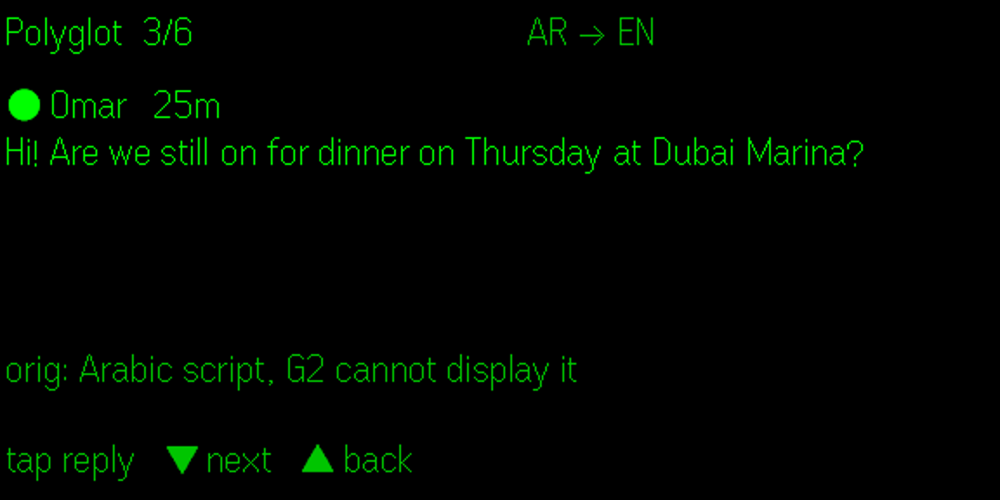
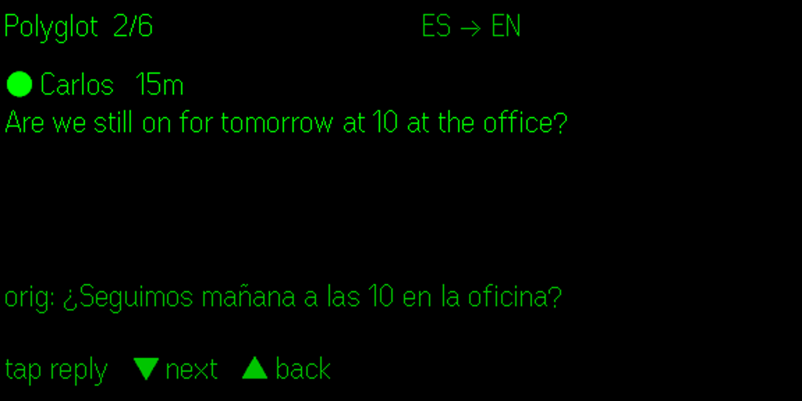
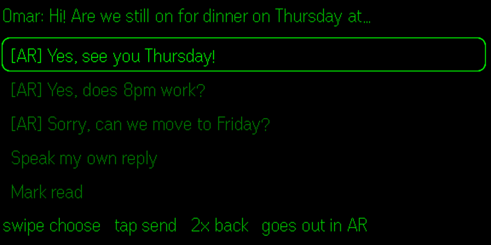
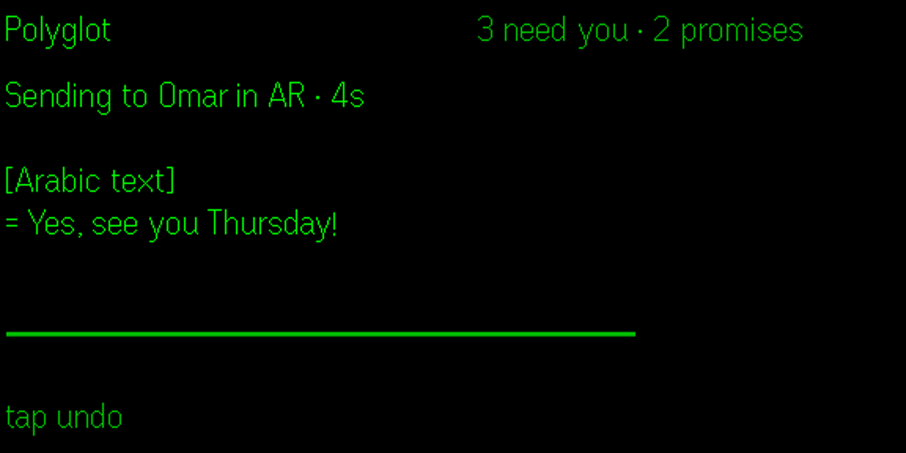
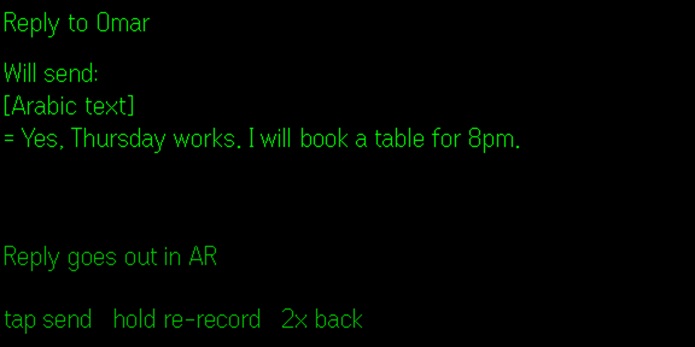
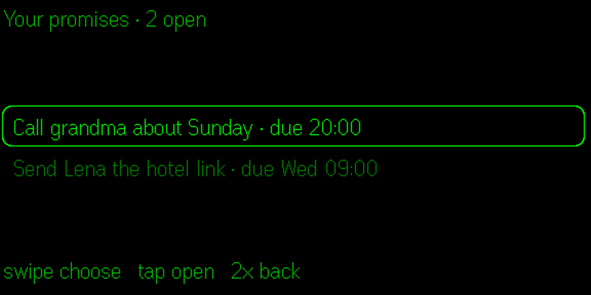
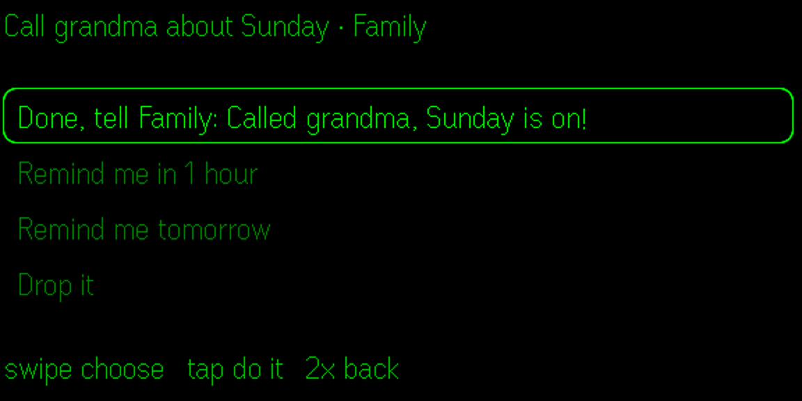
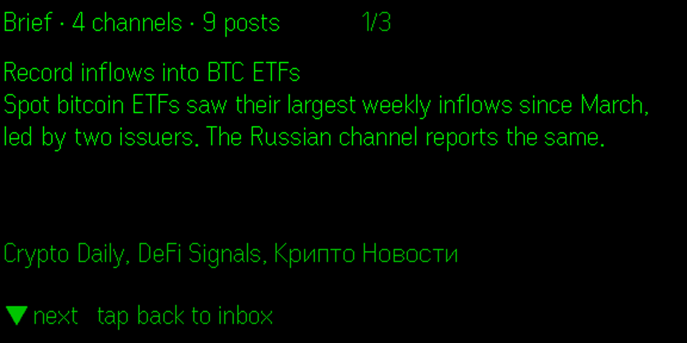
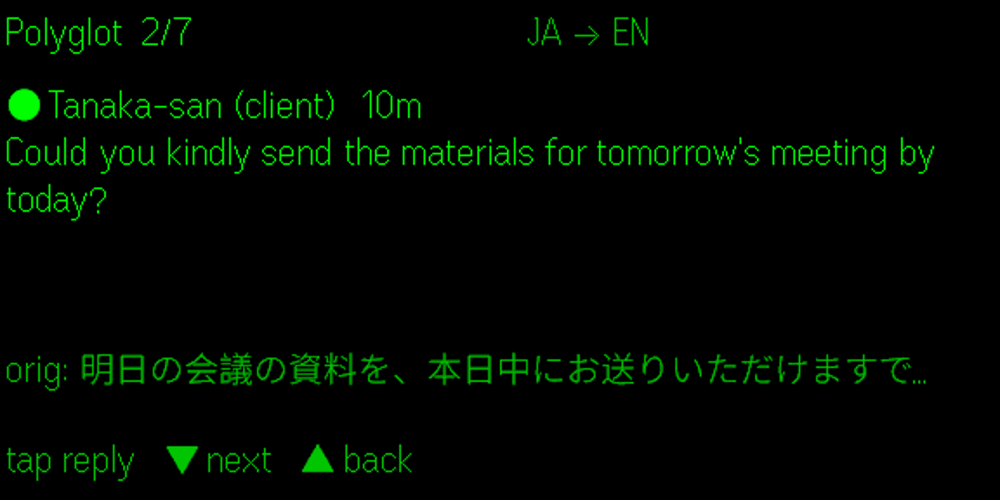
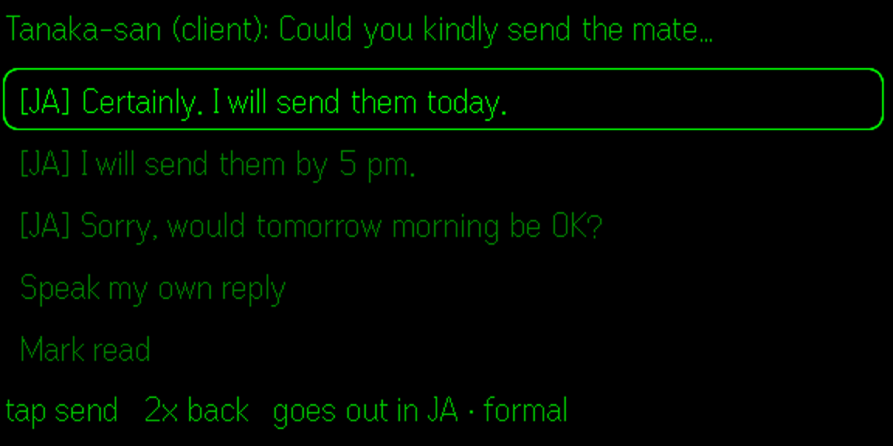

# Polyglot

**Telegram in every language, at a glance on Even Realities G2.** Read any message in your language, answer in theirs with one tap or one sentence, and never forget what you promised.

**▶ Demo video: [youtu.be/fKfY8OU5DG0](https://youtu.be/fKfY8OU5DG0)** · **BUIDL: [dorahacks.io/build/51806](https://dorahacks.io/build/51806)**

Built for the [Heads Up: Even Realities Hackathon](https://dorahacks.io/hackathon/even-realities/detail), **Track 01 · Messaging & News** (also entered for *Best Telegram integration*).



## The problem

Telegram is where international work groups, crypto communities and friends abroad talk, in Spanish, Russian, Arabic, Chinese and English, all in the same day. On your phone you copy-paste into a translator. On G2 it is worse: **the G2 font cannot draw Arabic, Hebrew or Hindi at all**. Those messages simply vanish from the display (we tested every script in the Even Hub simulator).

And when you do answer on the go ("I'll send it by 2", "te llamo mañana"), those promises get lost in the chat.

## Who it's for

People who live in multilingual Telegram: founders and remote teams across countries, traders in global crypto communities, expats and families spread across languages. Dubai, where Demo Day happens, is the perfect example.

## What Polyglot does

1. **Read any language.** Every message in your focus chats arrives translated into your language (16 to choose from). The original stays one line below; if G2 cannot draw its script, Polyglot says so instead of showing an empty screen.
2. **Reply in theirs, with one tap.** Tap: three replies written in the sender's language by a native-speaker model. Each one is shown by its **meaning in your language** (`[AR] Yes, see you Thursday!`), so you always know what you send.
3. **Speak your language, send theirs.** Hold the touchpad and say one sentence in your own language. Whisper transcribes the G2 microphone, the LLM cleans it up and translates it; you see the meaning and the real text, then tap to send.
4. **5-second undo.** Every send shows the exact text and its meaning, with a countdown you can cancel.
5. **Promise tracker.** Polyglot reads what *you* wrote and spots commitments in any language ("I'll send you the hotel link tomorrow"). They appear with a due time; one tap tells the other person it's done, in their language. Or snooze it.
6. **The right tone for every chat.** A reply to a client in Japanese needs keigo, a reply to a friend in Spanish needs *tú*. Polyglot reads the register from each chat's history (keigo vs plain, Sie vs du, usted vs tú, vous vs tu, вы vs ты) and defaults to formal for work and unknown contacts. You can pin it per chat. The reply list shows it: `goes out in JA · formal`.
7. **"Needs you" radar.** Messages that ask you something, mention you or set a deadline come first, with a one-line gist.
8. **Channel brief across languages.** Your news and crypto channels merged into 3 points, even when the same story comes from an English and a Russian channel.
9. **Mark read / mute 1 h** from the reply list. Phone page in English or German.

| Read any language | Arabic, which G2 can't draw | Replies by meaning |
|---|---|---|
|  |  |  |
| **Sending, with undo** | **Speak yours, send theirs** | **Your promises** |
|  |  |  |
| **Close the loop in one tap** | **Brief across languages** | **Needs-you radar** |
|  |  |  |

| **Japanese client** | **Replies in keigo** | |
|---|---|---|
|  |  | |

### Controls

| Where | Gesture | Action |
|---|---|---|
| Inbox | swipe down / up | next / previous message |
| Inbox | tap | reply drafts in the sender's language |
| Inbox, reply list | hold | voice reply (speak your language) |
| Reply list | swipe + tap | send, speak, mark read, mute 1 h |
| Voice | release or tap | stop recording; tap again to send |
| Sending | tap | undo |
| Promises | swipe + tap | done (tell them), remind in 1 h, tomorrow, drop |
| Anywhere | system menu | Promises · Channel brief · Mark all read · Refresh |
| Inbox | double tap | exit (system dialog) |

Works with the G2 temple touchpads and the R1 ring.

## Real-life moments we designed for

| Moment | What Polyglot does |
|---|---|
| Your Japanese client asks for the deck, mid-meeting | Shows it in your language, offers three keigo replies, sends one with a tap |
| A friend in Madrid asks about tomorrow | Casual *tú* replies, because that is how you two write |
| Omar writes in Arabic, which G2 cannot draw | Translation on the display, reply in Arabic, you see what it means |
| You promised "I'll book a table" while walking | Lands in Promises with a due time; one tap tells him it's done |
| Your hands are full | Hold, speak one sentence in your language, tap to send |
| You tapped the wrong reply | 5 seconds to undo, showing exactly what would go out |
| You want it to only read for now | Read-only mode: nothing is ever sent |

## Trust: signing in with your Telegram account

Polyglot needs a real Telegram session to see your private chats, so trust is part of the product, not an afterthought.

- **Self-host first.** The code is open source and runs on your own Mac or server with your own keys (`start-mac.command`). Nothing leaves it except calls to Telegram, your LLM and Whisper.
- **Your device holds half the key.** Each Telegram session is encrypted with AES-256-GCM under a key derived from the server secret *and* your device token. The server stores only a hash of that token, so the data file plus the server secret are still not enough to open a session.
- **Data minimization.** Only the chats you pick are read. Messages are never stored. The LLM sees only the message being handled and up to 8 lines of context.
- **You stay in control.** Read-only mode, 5-second undo, a content-free activity log on the phone page ("Sent a reply to Omar (AR)"), and sign-out deletes the account. Polyglot also shows up in Telegram itself under *Settings → Devices* as "Polyglot (Even G2)", where you can end the session at any time.
- **Next for a hosted version:** sessions sealed in a trusted execution environment, an independent security review, and a bot-based mode (Telegram Business) for people who don't want a full session at all.

## What it costs per user

The phone page has a live cost meter: Polyglot counts the real tokens and audio seconds of every call for each account and shows this month's API cost.

Our estimate for a **heavy user** (200 messages a day in focus chats, 20 reply drafts, 5 voice replies, 60 own messages scanned for promises, 2 channel briefs):

| Item per month | Volume | Tokens / audio |
|---|---|---|
| Read, triage, translate | 6,000 messages | ≈ 0.84 M in, 0.36 M out |
| Reply drafts | 600 | ≈ 0.39 M in, 0.11 M out |
| Promises scan | 1,800 own messages | ≈ 0.14 M in, 0.03 M out |
| Channel briefs | 60 | ≈ 0.18 M in, 0.02 M out |
| Voice replies | 150 | ≈ 30 min of audio |

That is about 1.6 M input and 0.5 M output tokens. With Qwen3 235B Instruct at [$0.071 / $0.463 per M tokens (OpenRouter)](https://openrouter.ai/qwen/qwen3-235b-a22b-2507/apps) it comes to **≈ $0.36 a month**; at a pricier host such as [$0.22 / $0.88](https://www.getmaxim.ai/bifrost/llm-cost-calculator/provider/fireworks_ai/model/qwen3-235b-a22b-instruct-2507) ≈ $0.82. Voice adds ≈ $0.02 with [Groq Whisper Large v3 Turbo at $0.04 per hour](https://groq.com/pricing) (billed with a 10-second minimum per request). A typical user with a quarter of that traffic costs ≈ $0.10–0.25 a month.

What keeps it cheap: messages are triaged in batches, every result is cached per message, only foreign-language messages get a translation, briefs run on demand, and a mid-size open model does the work. Prices are configurable (`PRICE_LLM_IN_PER_M`, `PRICE_LLM_OUT_PER_M`, `PRICE_STT_PER_HOUR`) so the meter matches whatever model you run.

## Who uses it every day, and who pays

- **Founders, BD and deal teams** whose deals live in Telegram across countries: crypto, Web3, trading desks, Dubai and Singapore offices.
- **Traders in foreign-language alpha groups** (Russian, Chinese, Korean, Turkish), who want the gist without copy-pasting.
- **Client-facing professionals in multilingual cities:** real estate agents, concierge and hospitality staff, recruiters, all answering clients in Arabic, Russian or Chinese.
- **Expats and families spread across languages.**

They already paid for premium glasses and use Telegram all day. Plan:

| Plan | Price | For |
|---|---|---|
| Open source, self-hosted | free, bring your own keys | developers, privacy-first users |
| Polyglot Pro (hosted) | $3.99 / month | individuals; API cost ≈ $0.10–0.80, so margins stay above 80 % |
| Polyglot Teams | $6 / seat / month | shared glossary and tone rules per client, admin controls |

## Architecture

```
Even G2 + R1  ──BLE──  Polyglot app (WebView in the Even Realities app)  ──HTTPS──  Polyglot server
 display, gestures,     glasses UI + phone settings page                           ├─ Telegram (MTProto, user account, GramJS)
 microphone                                                                         ├─ Whisper (Groq)
                                                                                    └─ LLM via Otari gateway (or Claude / OpenAI)
```

- **`app/`**: Vite + TypeScript, `@evenrealities/even_hub_sdk` 0.0.16. Declarative screens on the 576 × 288 canvas; text updates in place (`textContainerUpgrade`), rebuild only when the layout changes. Native list containers for replies and promises, contextual menu for global actions. Detects scripts the G2 font cannot draw and never sends them to the display. The same page renders the phone-side sign-in and settings (EN/DE).
- **`server/`**: Fastify + GramJS. One LLM layer for [Otari](https://otari.ai) (OpenAI-compatible, follows region redirects), Claude or OpenAI; every AI step has a fallback so the app keeps working without a key. The only place that holds API keys. Proper CORS for the WebView. Telegram sessions encrypted at rest (AES-256-GCM); device tokens stored only as SHA-256 hashes. Connects to Telegram on port 443 first (port 80 is often blocked), with a `/diag` page to check the network.
- **Why a user account, not a bot:** a bot cannot see your private chats. Polyglot uses Telegram's official client API with its own `api_id`.
- **Sign-in without Google:** phone number + Telegram code (+ 2FA password) on the phone page.

### Privacy and safety

- Messages are never stored. The server reads only the chats you picked, keeps them in memory and sends only the message being handled (plus a few lines of context) to the LLM.
- Promises store only a short summary and the chat reference. "Sign out" deletes the encrypted session and everything else.
- No money involved; no keys in the app or the repo.

## Run it

Requirements: Node.js 20+.

### Quick start on a Mac

Double-click `start-mac.command`. On first run it creates `server/.env` with a random `SERVER_SECRET`, opens it for your keys, installs everything and starts the server (port 8787) and the app (port 5173). Then:

```bash
npx @evenrealities/evenhub-simulator http://localhost:5173
```

### By hand

```bash
cd server && cp .env.example .env && npm install && npm run dev     # http://localhost:8787
cd app && npm install && npm run dev                                 # http://localhost:5173
npx @evenrealities/evenhub-simulator "http://localhost:5173/?demo"   # ?demo = keyless demo account
```

| Variable | Needed for |
|---|---|
| `SERVER_SECRET` | storing Telegram sessions (any 32+ random chars) |
| `TG_API_ID`, `TG_API_HASH` | real Telegram login ([my.telegram.org/apps](https://my.telegram.org/apps)) |
| `AI_PROVIDER` + `OTARI_API_KEY` | translation, replies, cleanup, promises, brief via [Otari](https://otari.ai) (`anthropic`/`openai` also supported) |
| `GROQ_API_KEY` | voice replies (Groq Whisper; `STT_PROVIDER=openai` also supported) |

Without keys the server still runs: the **demo account** has fictional chats in English, Spanish and Arabic, a Russian channel and scripted AI output, so the whole flow can be tried in the simulator.

### On real G2

```bash
cd app
npx evenhub qr --url "http://<your-lan-ip>:5173"
```

Scan the QR code in the Even Realities app (phone and Mac on the same Wi-Fi). For a packaged build, set `VITE_API_URL` to your public server, add it to `app.json` → `permissions` → `network.whitelist`, then `npm run pack`.

### Server anywhere else

The server also runs on any Node host. `server/Dockerfile` and `server/fly.toml` are included for Fly.io (`fly launch --copy-config`, `fly volumes create polyglot_data --size 1`, `fly secrets set ...`, `fly deploy`).

## What existed before November 23, 2026

- The project structure of `app/` (`index.html`, `vite.config.ts`, `tsconfig.json`) comes from the official Even Hub `minimal` template.
- Open-source libraries: Even Hub SDK/CLI/simulator, GramJS (`telegram`), Fastify, Vite, TypeScript.
- Before the build week we only wrote a plan and static screen mockups. All application code in this repo was written during the hackathon (Nov 23–29, 2026). The project was first called TeleGlance and renamed to Polyglot on Nov 24.

## Feature requests for the Telegram API

1. **Read access for bots in private chats with explicit user consent** (an OAuth-style "let this app read these 3 chats" grant), so wearables don't need full user-account sessions.
2. **Message language in the API**: Telegram already detects languages for its built-in translation; exposing a `lang` field per message would save a model call per message.
3. **Translation open to third-party clients**, with the same quality as the built-in translation in the official apps, so every client doesn't need its own model.
4. **Scoped sessions**: an MTProto session limited to chosen chats and read/send only, revocable per device.
5. **An official push channel for companion devices** (webhook-style updates for a user session) instead of keeping a persistent MTProto connection open.

## License

MIT
